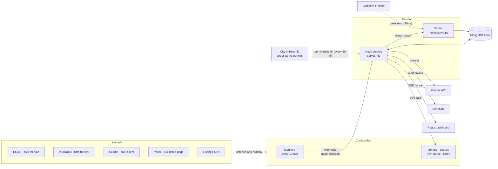
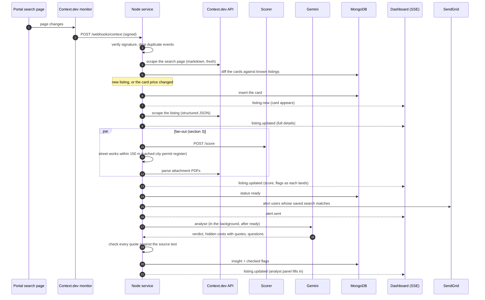
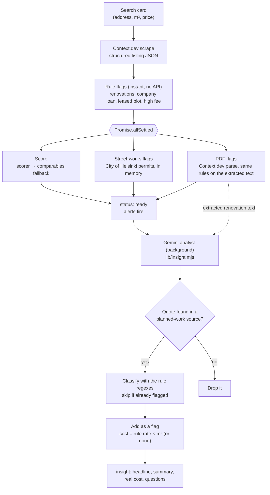
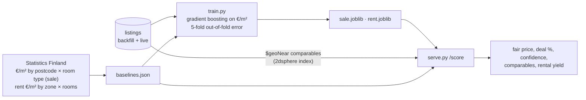
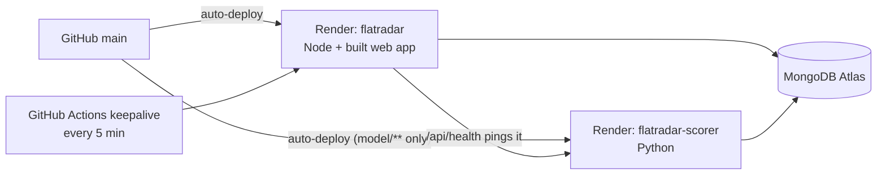

# FlatRadar architecture

FlatRadar watches Helsinki flat listings on the live web. When a flat appears or its price changes, it scores the price against fair value, flags hidden costs and neighbourhood risks, explains it all in plain English, and alerts anyone whose saved search matches.

The shared data shapes are in [contracts.md](contracts.md). This page shows how the pieces connect.

## 1. System overview

- **One Node process** does ingestion, enrichment, the API, the SSE stream and alerts. It needs to stay running because of SSE and the in-process event bus. On Render's free tier it is kept awake by a GitHub Actions ping to `/api/health` every 5 minutes (`.github/workflows/keepalive.yml`).
- **The scorer** is a separate Python service. Node waits up to 3 s for it, then falls back to its own score from comparable listings (`lib/score/index.mjs`).
- **Gemini** is optional. Without `GEMINI_API_KEY` the analyst step is skipped and alerts, scores and flags work as before.

## 2. From a new listing to an alert

Gemini runs after the listing is marked ready and isn't awaited, so it never delays the alert email or the measured latency (`enrich_ms`). In tests on real listings it took 3–8 s (it writes English and Finnish).

**Demo path:** `POST /mock/publish` adds a flat to our own `/mock` page and calls `run-monitor-now`. Context.dev then sees the change and calls our webhook like any real portal. If no webhook arrives within 40 s, the server diffs `/mock` itself.

## 3. Enrichment fan-out (`lib/enrich.mjs`)

- Every branch is optional. A slow or failed call leaves a "pending" or missing flag instead of blocking the card.
- Each external call goes through `call()` or `track()` in `lib/context.mjs`. These record the endpoint, timing and status, and stream them as `call.start` / `call.end` events. That powers the per-listing waterfall (the fan-out drawer). Context.dev calls share a limit of 30 at a time, leaving room for monitors and batches within the account's 50.
- **What Gemini does and doesn't decide:**
  - It writes the words: verdict, explanations, questions.
  - It proposes extra hidden costs. Each one is kept only if its quote (at least 12 characters) appears word for word in the *planned* renovations text of the listing or a PDF. Completed work is shown to the model as context it can't cite.
  - It never sets a number. The kind of work is classified with the same regexes as the rule flags (`lib/flags/renovations.mjs`, plus facade seams and yard/drainage in `lib/insight.mjs`), which gives the € per m² and the chip label. Unrecognised work gets no cost. The year comes from the quoted text.
  - Totals are summed in code, counting each kind of work once.
  - Each run re-reads the listing when it starts and has a token. A run that has been superseded (a newer run, or a re-enrichment) writes nothing. The write swaps Gemini's flags atomically, so it never overwrites other flags.
  - Runs cut off by a restart or deploy are retried at startup and every 3 minutes.

## 4. How fair value is computed (`model/`)

Fair value blends the model with the median of nearby comparable listings. If a piece is missing, it degrades step by step (model only → comparables only → Statistics Finland baseline) instead of failing. Error figures per estimator are in `model/report.json`.

## 5. Data (MongoDB Atlas, database `flatradar`)

| Collection | What's in it |
|---|---|
| `listings` | One document per flat (`portal:id`): details, location (2dsphere index), price history, `score`, `flags`, `insight`, status |
| `users`, `sessions` | Accounts, saved searches, sign-in sessions (httpOnly cookie) |
| `alerts` | Which user was alerted about which listing, so nobody gets the same alert twice |
| `monitors` | Context.dev monitor ids and webhook signing secrets |
| `webhook_events` | Received webhook ids, for deduplication and "last webhook" health |
| `runs` | Backfill batches and each search-page diff (cards seen, which changed) |
| `calls` | Telemetry for every external call (endpoint, ms, status), shown in the fan-out drawer |
| `mock_listings` | Flats published to the demo `/mock` page |
| `baselines` | Statistics Finland baselines (also committed as `model/data/baselines.json`) |

## 6. External services

| Service | Used for | Where |
|---|---|---|
| Context.dev monitors + webhooks | Detect changes on the portal search pages and `/mock` | `lib/monitors.mjs` |
| Context.dev scrape (markdown) | Read search pages to diff the cards | `lib/monitors.mjs` |
| Context.dev scrape (JSON schema) | Extract each listing's fields | `lib/ingest/portals.mjs`, `lib/enrich.mjs` |
| Context.dev scrape (PDF parser) | Renovation plans and loans from attachments | `lib/flags/documents.mjs` |
| City of Helsinki permit register (WFS open data) | Significant street works and traffic diversions within 150 m of the flat | `lib/flags/streetworks.mjs` |
| Context.dev scrape, Oikotie page 1 every 10 min | Oikotie renders its results client-side and monitor page targets can't wait for that, so the server polls it (`POLL_MINUTES`) | `lib/monitors.mjs` (`pollUnmonitored`) |
| Context.dev monitors, one per listing page (every 2 h, up to `LISTING_MONITOR_MAX`) | Price drops, fee changes and sold/removed on every Etuovi and Vuokraovi listing. Created when a listing is enriched, deleted when it's gone | `lib/listing-monitors.mjs` |
| Context.dev scrape, search pages 2–12 (hourly) | Price sweep. Off by default while listing monitors are on; set `PRICE_SWEEP_MINUTES` to force it | `lib/monitors.mjs` (`sweepPrices`) |
| Context.dev batch | Backfill hundreds of listings for training and comparables | `scripts/backfill.mjs` |
| Gemini API | Plain-English verdict, extra hidden costs (quote-checked), questions for the agent | `lib/insight.mjs` |
| MongoDB Atlas | Storage, `$geoNear` comparables | `lib/db.mjs`, `model/common.py` |
| SendGrid | Alert emails | `lib/alerts/index.mjs` |
| Statistics Finland PxWeb | Price and rent baselines by area | `model/baselines.py` |

## 7. Deployment

Environment variables on the Node service: `CONTEXT_DEV_API_KEY`, `MONGODB_URI`, `PUBLIC_URL`, `ADMIN_TOKEN`, `SENDGRID_API_KEY`, `SENDGRID_FROM`, `SCORER_URL`, `GEMINI_API_KEY`. `GEMINI_MODEL` is optional (default `gemini-3.8-flash`). The scorer needs only `MONGODB_URI`. The blueprint is `render.yaml`.
